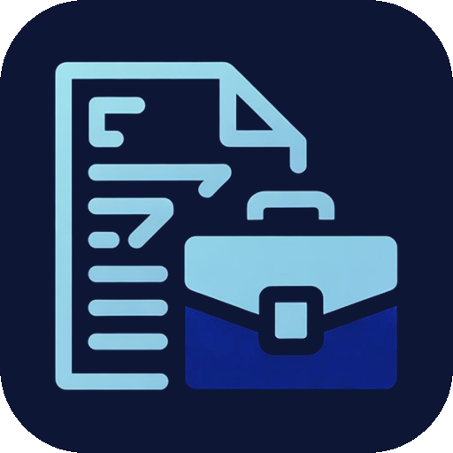
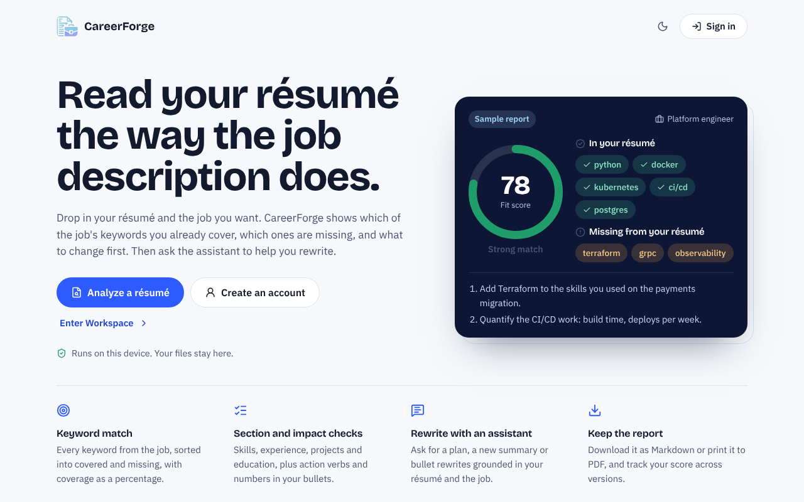
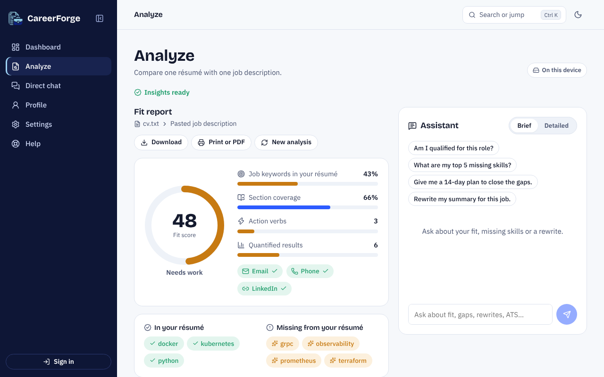
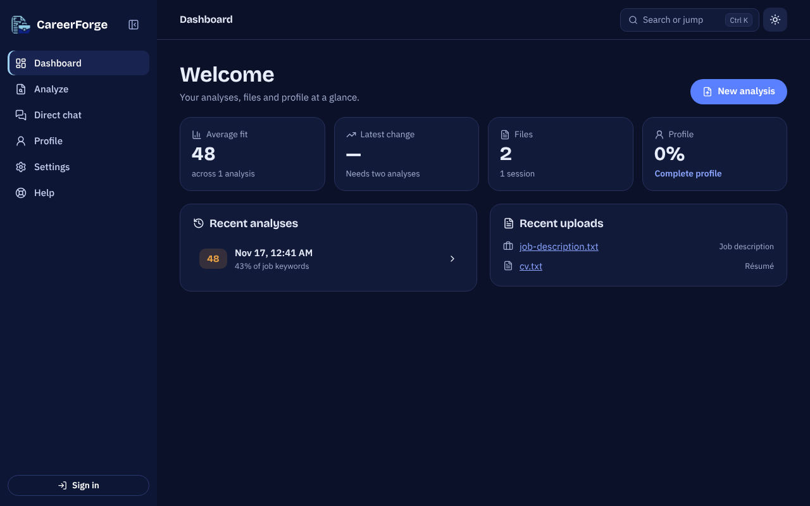
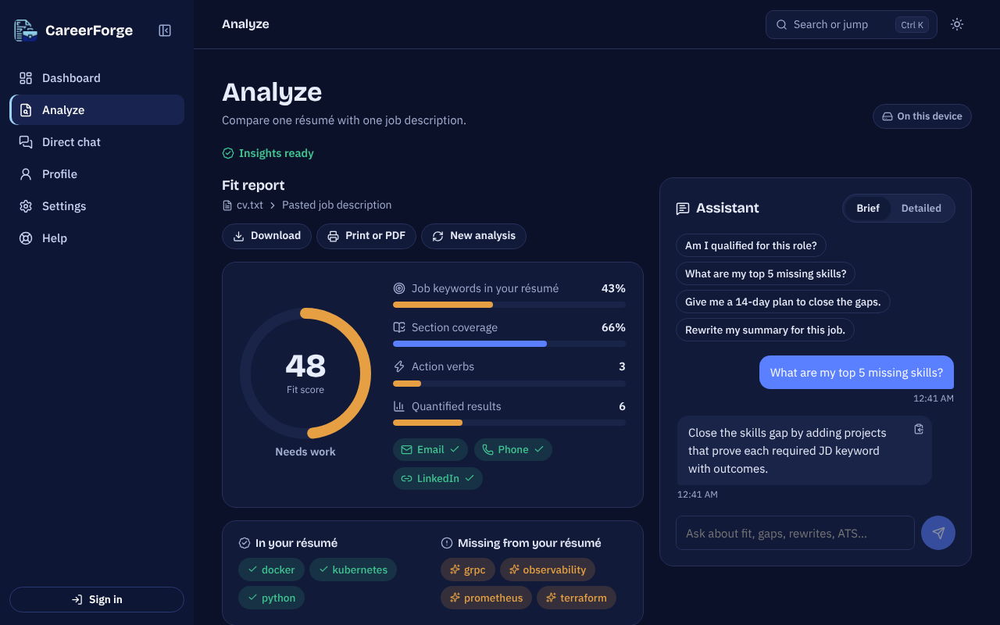
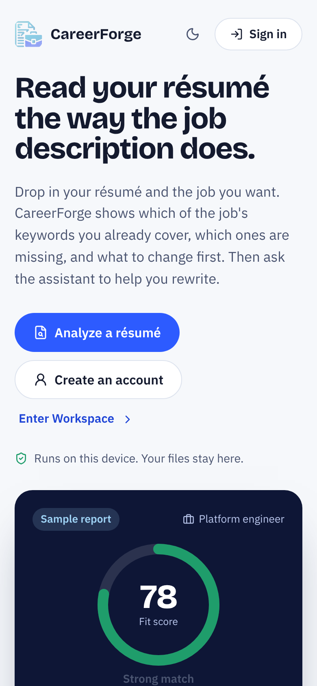
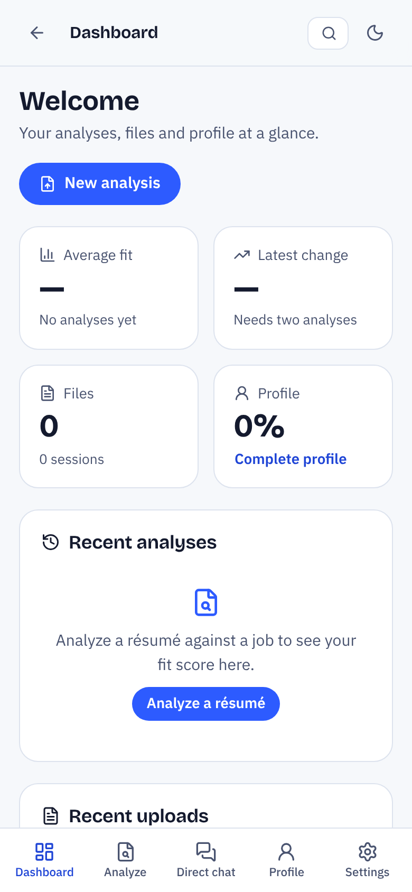
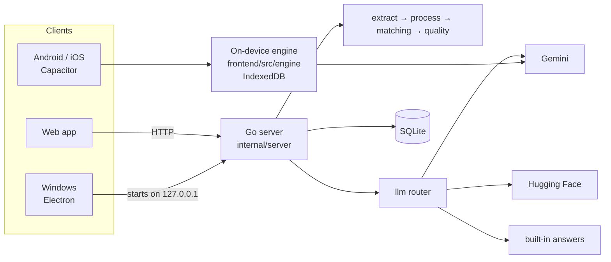

<div align="center">



# CareerForge

### See how your résumé reads against the job description, then fix what is missing.

[](https://github.com/shiroonigami23-ui/careerforge-go/actions/workflows/ci.yml)
[](https://github.com/shiroonigami23-ui/careerforge-go/actions/workflows/release.yml)
[](https://github.com/shiroonigami23-ui/careerforge-go/releases/latest)
[](LICENSE)


[Download](#download) · [Screenshots](#screenshots) · [Features](#features) · [How the score works](#how-the-fit-score-works) · [Run it yourself](#run-it-yourself) · [Testing](#testing) · [Security](#security-and-privacy) · [Roadmap](docs/ROADMAP.md)


</div>

## Download

Every release ships for every platform from the same tag. Get them from the **[latest release](https://github.com/shiroonigami23-ui/careerforge-go/releases/latest)**:

| Platform | File | Notes |
|---|---|---|
| Android | `CareerForge-vX.Y.Z.apk` | Runs fully on the phone. Allow "install unknown apps" for your browser or file manager. |
| Windows | `CareerForge-Setup-X.Y.Z.exe` | Installer with Start-menu and desktop shortcuts. |
| Windows | `CareerForge-Portable-X.Y.Z.exe` | No installation; just run it. |
| Windows | `careerforge-server-windows-amd64.exe` | Server only: run it and open http://127.0.0.1:8080. |
| iOS | `CareerForge-vX.Y.Z-unsigned.ipa` | **Unsigned.** Install with a sideloading tool such as [AltStore](https://altstore.io) or [Sideloadly](https://sideloadly.io), which signs it with your own Apple ID (free accounts re-sign every 7 days). |

Windows may show a SmartScreen warning because the EXEs are not code-signed: choose **More info → Run anyway**.

## Screenshots

| Start page | Fit report and assistant |
|---|---|
|  |  |
| **Dashboard, dark theme** | **Report, dark theme** |
|  |  |

<p align="center">
  
  &nbsp;
  
</p>

## Features

| | Feature | What it does |
|---|---|---|
| 🎯 | **Fit score** | A 0–100 dial with the four measures behind it: job keywords covered, section coverage, action verbs and quantified results. |
| 🔑 | **Keyword map** | Every important keyword from the job, split into *in your résumé* and *missing*. Click a missing one to ask how to add it honestly. |
| ✅ | **Fix-first checklist** | Concrete improvements, ticked off as you go and remembered per analysis. |
| 💬 | **Assistant** | Brief or detailed answers about fit, gaps, a 14-day plan or a rewritten summary, grounded in your résumé and the job. Uses Gemini when a key is set, built-in answers otherwise. |
| 📄 | **Keep the report** | Download as Markdown or print / save as PDF (print layout shows only the report). |
| 📈 | **History** | Dashboard with average fit, the change since your previous analysis, and every past analysis one click away. |
| 📁 | **Formats** | PDF, DOCX, TXT, Markdown and EPUB up to 10 MB; JPG, PNG, WebP, GIF and BMP up to 5 MB (images are read with Gemini). Drag and drop or pick a file. |
| 👤 | **Accounts and profile** | Email/password or Google sign-in, profile photo, headline and bio, profile lookup by user ID. Guests can analyse without an account. |
| 🤝 | **Direct chat** | Device-to-device chat with a mentor over WebRTC; messages never touch a server. |
| 🌗 | **Comfort** | Light and dark themes, Ctrl/⌘+K quick navigation, Alt+1…6 shortcuts, mobile bottom navigation, reduced-motion support. |
| 📱 | **Everywhere** | Android and iOS apps run entirely on the device; Windows app bundles the Go server; the server also serves the web app. |

## How the fit score works

```
fit = 0.45 × keyword coverage + 0.25 × section coverage + 1.2 × min(action verbs, 25) + 1.5 × min(quantified results, 20)   (capped at 100)
```

- **Keyword coverage**: the most frequent meaningful words in the job description (151 filler words such as *and*, *experience*, *team* are ignored), and the share that also appear in the résumé.
- **Section coverage**: distinct sections found (contact, skills, experience, projects, education, certifications…) out of six.
- **75 and above** is a strong match (green), 50–74 workable (blue), below 50 needs work (amber).

The Go server and the on-device engine implement this identically; a shared fixture (`tests/fixtures/quality_cases.json`) checks both against hand-computed results.

## Architecture



The web UI asks `/dashboard/__probe__` on start-up: a JSON answer means a Go server is present; otherwise everything runs in the browser or app. Design notes: [docs/ARCHITECTURE.md](docs/ARCHITECTURE.md).

```text
careerforge-go/
├── cmd/careerforge/        Go entry point; embeds the built UI (web/dist)
├── internal/               server, extract, process, matching, quality, llm, db, store, faq
├── frontend/               React UI, on-device engine (src/engine), Capacitor android/ and ios/
├── desktop/                Electron shell (splash window, Go server sidecar)
├── tests/                  shared fixtures, test runner, recorded results
├── scripts/                icon generator, roadmap PDF builder
└── .github/workflows/      ci.yml, release.yml, android-apk.yml, changelog.yml
```

## Run it yourself

**Prerequisites:** Go 1.22+, Node 22+. For the apps: JDK 21 and the Android SDK (APK), Xcode 16 (iOS), Windows for the Electron build.

```bash
git clone https://github.com/shiroonigami23-ui/careerforge-go.git
cd careerforge-go
cd frontend && npm ci && npm run build && cd ..   # builds the UI into cmd/careerforge/web/dist
go run ./cmd/careerforge                          # http://localhost:8080
```

| Variable | Purpose |
|---|---|
| `APP_API_KEY` | Gemini API key used by the server |
| `GEMINI_MODEL` | Gemini model name (default `gemini-flash-latest`) |
| `HF_TOKEN`, `HF_MODEL_ID` | Optional Hugging Face provider |
| `LLM_PROVIDER` | Force `gemini` or `hf` |
| `GOOGLE_CLIENT_ID` / `VITE_GOOGLE_CLIENT_ID` | Google sign-in (server audience check / UI button) |
| `HOST`, `PORT` | Listen address (the desktop app uses `HOST=127.0.0.1`) |
| `CAREERFORGE_ROOT` | Where `data/` and `uploaded_files/` live |

**Apps**

```bash
cd frontend
npm run build:android && npx cap sync android && (cd android && ./gradlew assembleRelease)
npm run build:ios && npx cap sync ios      # then open ios/App/App.xcodeproj in Xcode
cd ../desktop && npm ci && npx electron-builder --win nsis portable   # after building the server into desktop/bin
```

**Release:** push a tag such as `v1.0.0`. `release.yml` builds the APK, the unsigned IPA (macOS runner) and the Windows installer and portable EXE, and attaches them to the GitHub Release. Pushing a `release-test/*` branch runs the same builds without publishing.

## Testing

```bash
node tests/run-all.mjs        # Go tests + engine tests + browser tests, recorded in tests/results/
```

| Suite | Covers |
|---|---|
| Go (`go test ./...`) | Password hashing (PBKDF2 test vector, legacy upgrade), file-size boundaries, profile completion numbers, résumé parsing regressions, quality-report numbers, stop-word parity with the JS engine, HTTP black-box tests: sign-up/sign-in, path traversal and database exposure on `/files/`, upload validation, the full upload → report → chat flow |
| Engine (Vitest) | The same numeric fixtures as Go, password hashing, the on-device API as a black box, UI tests (landing, analyzer, file validation, sign-in dialog, theme) |
| Browser (Playwright) | Splash shown ≥ 2 s, navigation, analysis end to end, checklist, assistant, Markdown download, history, Ctrl+K, mobile layout |

The latest run is in [tests/results/LATEST.md](tests/results/LATEST.md). CI runs every suite on each push and attaches the record to the workflow run.

## Security and privacy

- On Android and iOS, accounts, files and reports stay on the device (IndexedDB). Text leaves the device only when you add a Gemini key.
- Passwords are stored as PBKDF2-HMAC-SHA256 with 210,000 iterations and a random salt; older hashes are upgraded at the next sign-in.
- Google sign-in tokens are verified with Google and must match `GOOGLE_CLIENT_ID`.
- `/files/` serves only uploaded files; the SQLite database and everything else under the data folder are never served (tested).
- The Gemini key is sent in the `x-goog-api-key` header, never in URLs or logs.
- The desktop app binds the server to `127.0.0.1` on a random free port.

## Roadmap

Highlights: synonym-aware keyword matching, ATS formatting checks, résumé versions per role, interview practice. Full plan in **[docs/ROADMAP.md](docs/ROADMAP.md)** ([PDF](docs/ROADMAP.pdf)).

## Contributing

1. Fork and create a branch: `git checkout -b feature/your-change`
2. Run `node tests/run-all.mjs` and `gofmt -l .` (should print nothing)
3. Open a pull request against `main`

## Changelog

See [CHANGELOG.md](CHANGELOG.md).

## License

MIT. See [LICENSE](LICENSE).

## Author

**Aryan Singh Chandel** (Shiro) · [GitHub @shiroonigami23-ui](https://github.com/shiroonigami23-ui)
