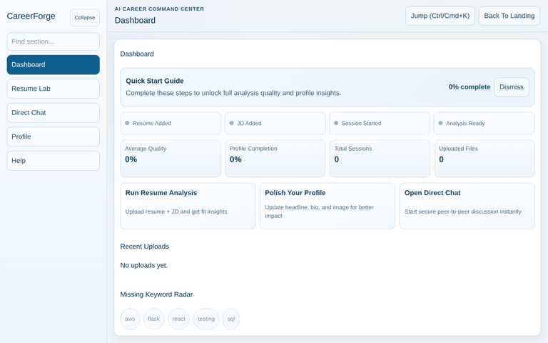
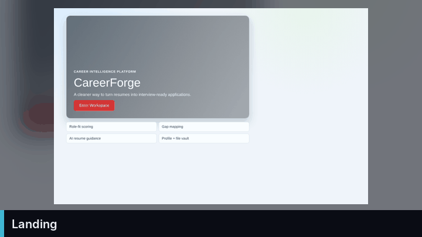
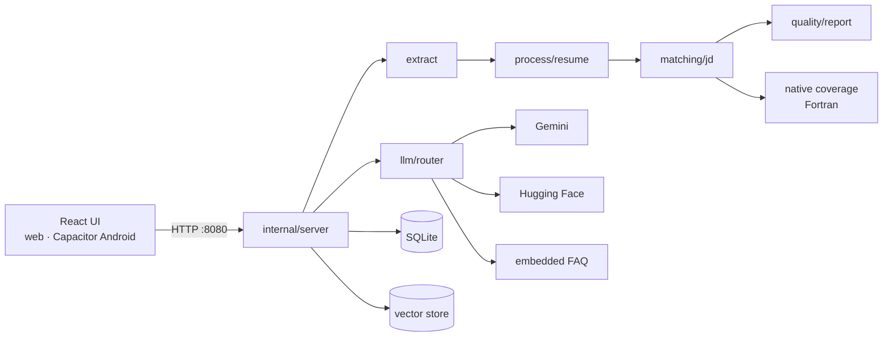

<div align="center">



<sub>Real recording of the React workspace (Dashboard → Resume Lab → Direct Chat → Profile)</sub>

# 🧭 CareerForge

### Resume ↔ job-description intelligence — Go + SQLite API, React UI, Gemini/HF, Android & Windows builds

       

[](LICENSE)    

[](https://codespaces.new/shiroonigami23-ui/careerforge-go?quickstart=1) [](https://github.com/shiroonigami23-ui/careerforge-go/archive/refs/heads/main.zip)

[**Overview**](#-overview) · [**Features**](#-features) · [**Architecture**](#-architecture) · [**Getting Started**](#-getting-started) · [**Roadmap**](#-roadmap)

</div>

---

## 📸 Preview

<p align="center"></p>

## 📖 Overview

**CareerForge** turns a resume and a job description into an actionable plan: **role-fit scoring**, **gap mapping**,
**missing-keyword radar**, quality reports and **AI resume guidance**. It is a Go rewrite of an earlier Python/Flask
project — a single **Go binary** serves a **SQLite-backed API** and the embedded **React** UI, routes LLM calls to
**Gemini** (with **Hugging Face** as an alternative), and ships as a **Windows EXE** and an **Android APK** (Capacitor) built
by GitHub Actions on every semver tag. A small **Fortran** kernel computes keyword coverage natively.

### ✨ Highlights

- **One static binary** — API + embedded React UI (`careerforge-windows-amd64.exe`)
- **Document pipeline** — extract → process → match (resume vs JD) → quality report
- **LLM routing** — Gemini primary, Hugging Face optional, embedded FAQ fallback
- **Release automation** — tag `vX.Y.Z` ⇒ signed APK + EXE attached to a GitHub Release; auto-CHANGELOG

## 🧩 Features

| Feature | What it does |
|---|---|
| **Resume Lab** | Upload resume + JD, get fit score, gaps and suggestions |
| **Missing-keyword radar** | Highlights skills the JD wants that the resume lacks |
| **Quality report** | `internal/quality` scores structure and completeness |
| **Direct Chat** | AI career assistant over your documents |
| **Profile & file vault** | Headline, bio, image, uploaded files |
| **Vector store** | `internal/store/vector.go` for similarity search |
| **Native coverage** | `native/fortran/coverage.F90` keyword coverage kernel |
| **Mobile** | Capacitor Android shell; `gomobile` path to run the server on-device |

## 🛠 Tech Stack

| Layer | Technology |
|---|---|
| Backend | Go 1.22, SQLite (modernc.org/sqlite) |
| Front-end | React 19, Vite, Tailwind, Playwright tests |
| AI | Gemini API, Hugging Face Inference |
| Native | Fortran (coverage kernel) |
| Mobile | Capacitor Android |
| CI/CD | GitHub Actions — Android CI, release, changelog |

## 🏗 Architecture

The Go server owns all logic; React talks to it over HTTP; the same server runs on desktop or (optionally) on-device.



➡️ Full design notes, data flow and design decisions: **[docs/ARCHITECTURE.md](docs/ARCHITECTURE.md)**

## 📁 Project Structure

```text
careerforge-go/
├── cmd/careerforge/     # entry point; embeds web/dist
├── internal/
│   ├── server/          # HTTP API
│   ├── extract/ process/ matching/ quality/   # document pipeline
│   ├── llm/             # provider router
│   ├── db/ store/       # SQLite + vector store
│   ├── faq/             # embedded FAQ responses
│   └── native/          # coverage + seed
├── native/fortran/coverage.F90
├── frontend/            # React + Vite + Capacitor android/
├── mobile/mobile.go     # gomobile bindings
└── .github/workflows/   # android-apk, release-apk, changelog
```

## 🚀 Getting Started

### Prerequisites

- Go 1.22+, Node 20+
- JDK 21+ and Android SDK for the APK

### 1. Get the code

Pick whichever method suits you:

| Method | Command |
|---|---|
| **HTTPS** | `git clone https://github.com/shiroonigami23-ui/careerforge-go.git` |
| **SSH** | `git clone git@github.com:shiroonigami23-ui/careerforge-go.git` |
| **GitHub CLI** | `gh repo clone shiroonigami23-ui/careerforge-go` |
| **ZIP** | [Download](https://github.com/shiroonigami23-ui/careerforge-go/archive/refs/heads/main.zip) and extract |
| **Codespaces** | [Open in browser](https://codespaces.new/shiroonigami23-ui/careerforge-go?quickstart=1) — zero local setup, dev container preconfigured |

> 🔑 **Using SSH for the first time?** Generate a key with `ssh-keygen -t ed25519 -C "you@example.com"`, add the `.pub` contents at **GitHub → Settings → SSH and GPG keys**, then test with `ssh -T git@github.com`.

### 2. Install & set up

```bash
cd careerforge-go
cd frontend && npm install && npm run build && cd ..
```

### 3. Run

```bash
export APP_API_KEY=...            # Gemini
export HF_TOKEN=... HF_MODEL_ID=... # optional
go run ./cmd/careerforge          # http://localhost:8080
```
**Android:** `cd frontend && npm run build:android && npx cap sync android && cd android && ./gradlew assembleDebug`,
then `adb reverse tcp:8080 tcp:8080` while the server runs on your PC.

**Release:** `git tag v0.1.0 && git push origin v0.1.0` → CI attaches `app-release.apk` and `careerforge-windows-amd64.exe`.

## ⚙️ Configuration

| Variable | Purpose |
|---|---|
| `APP_API_KEY` | Gemini API key |
| `HF_TOKEN`, `HF_MODEL_ID` | Optional Hugging Face provider |
| `ANDROID_KEYSTORE_BASE64`, `ANDROID_KEYSTORE_PASSWORD`, `ANDROID_KEY_ALIAS`, `ANDROID_KEY_PASSWORD` | Repo secrets for Play-ready signing (debug-signed if absent) |

## 🗺 Roadmap

**v1 — Go rewrite (done)**

- [x] Go API + SQLite, embedded React UI
- [x] Resume/JD pipeline, quality report, keyword radar
- [x] Gemini/HF routing with FAQ fallback
- [x] APK + EXE release automation, auto-changelog

**v1.1 — Smarter analysis**

- [ ] Section-level rewrite suggestions with before/after diff
- [ ] ATS-style parsing check and formatting warnings
- [ ] Semantic skill matching with embeddings in the vector store

**v1.2 — Platform**

- [ ] On-device server via gomobile by default (fully offline Android)
- [ ] Job-board import (paste URL → JD)
- [ ] Multi-resume versions per target role

**v2.0**

- [ ] Interview-prep mode generating role-specific questions
- [ ] Cover-letter generator grounded in the matched evidence

➡️ Detailed plan, milestones and long-term vision: **[docs/ROADMAP.md](docs/ROADMAP.md)**

## 🤝 Contributing

Contributions, issues and feature requests are welcome!

1. Fork the repository
2. Create a feature branch: `git checkout -b feature/amazing-feature`
3. Commit your changes: `git commit -m "feat: add amazing feature"`
4. Push the branch: `git push origin feature/amazing-feature`
5. Open a Pull Request against `main`

Check the [issues page](https://github.com/shiroonigami23-ui/careerforge-go/issues) and the [roadmap](docs/ROADMAP.md) for ideas on where to help.

## 📜 Changelog

See [CHANGELOG.md](CHANGELOG.md) for the release history.

## 📄 License

Distributed under the **MIT** license. See [LICENSE](LICENSE) for details.

## 👤 Author

**Aryan Singh Chandel** (Shiro)

[](https://github.com/shiroonigami23-ui)

<div align="center">

⭐ **If you find this project useful, consider giving it a star!** ⭐

</div>
