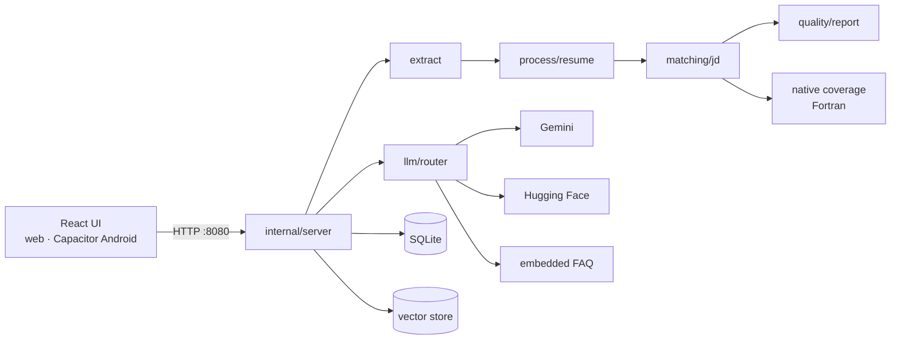

# 🏗 Architecture — CareerForge

> Part of [careerforge-go](https://github.com/shiroonigami23-ui/careerforge-go). Back to the [README](../README.md).

## 1. System Overview

A single Go process exposes the REST API and serves the compiled React app. Documents flow through extract →
process → matching → quality packages; LLM calls go through a router that picks Gemini, Hugging Face or the embedded
FAQ. Data lives in SQLite plus a lightweight vector store. The Android app is the same React build inside Capacitor.

## 2. Components

| Component | Location | Responsibility |
|---|---|---|
| **Entry** | `cmd/careerforge` | Starts server, embeds `web/dist` |
| **API** | `internal/server/server.go` | Routes for analysis, chat, profile, files |
| **Pipeline** | `internal/extract, internal/process, internal/matching` | Text extraction, resume parsing, JD matching |
| **Quality** | `internal/quality/report.go` | Scoring and report generation |
| **LLM** | `internal/llm/router.go` | Provider selection and fallback |
| **Storage** | `internal/db, internal/store` | SQLite and vectors |
| **Native** | `native/fortran, internal/native` | Coverage kernel and seeding |

## 3. Data / Control Flow

1. The user uploads a resume and pastes a JD in Resume Lab.
2. The server extracts text, parses sections and computes keyword coverage and fit.
3. A quality report and gaps are stored in SQLite and returned.
4. Chat requests are answered by the LLM router using the stored context.

## 4. Key Design Decisions

| Decision | Rationale |
|---|---|
| Go rewrite of Flask | Single binary, easy Windows distribution, low memory |
| Embedded UI | No separate web server to deploy |
| Debug-signed fallback | Release CI never fails just because secrets are missing |

## 5. Known Limitations

- Android build expects the server on the PC unless gomobile integration is used

---
*Last updated: 2026-11-13*
